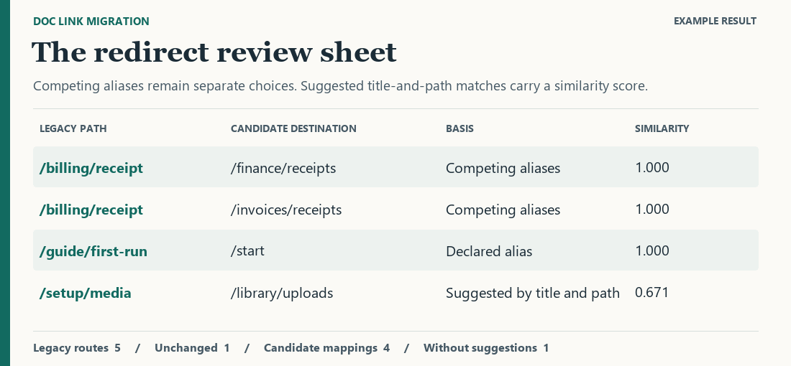
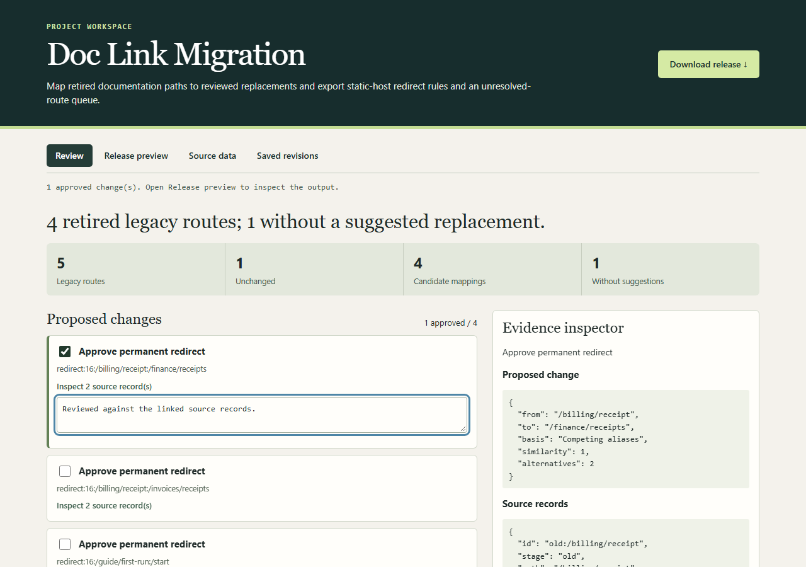

# Doc Link Migration

Map retired documentation paths to reviewed replacements and export static-host redirect rules and an unresolved-route queue.

**[Open the live demo](https://oguzhanozfe.github.io/doc-link-migration/)** · [](https://github.com/oguzhanozfe/doc-link-migration/actions/workflows/check.yml) · [Deploy to Render](https://render.com/deploy?repo=https://github.com/oguzhanozfe/doc-link-migration) · [Input guide](GUIDE.md)

A documentation move leaves readers at retired URLs. Compare replacement candidates and export only the redirects you can defend.



The live demo lets you edit the input, search proposed changes with an on-device model and download the result. [Browser demo details](demo/DEMO.md)

## Try it

With Python 3.11+ installed, clone this repository and run:

```sh
git clone https://github.com/oguzhanozfe/doc-link-migration.git
cd doc-link-migration
python app.py
```

Open <http://127.0.0.1:8000>. The synthetic example is loaded. Select a proposed change, inspect its source records, and open **Release preview** to see the resulting files. Choose **Download release** to save them.

## Walk through the example

Supply lists of old and new paths with their page titles. New pages can list previously published addresses in aliases. Paths must be literal site-root paths. The importer normalizes a trailing slash and rejects external addresses, query strings and relative traversal. Split large sites into documentation sections before comparing them.

**What the engine finds.** 4 retired legacy routes; 1 without a suggested replacement.

**Try this decision.** Approve **Approve permanent redirect**. The [example review](docs/example-review.json) lists the supporting record IDs and the checksum of each exported file. Its native outputs are [`_redirects`](docs/example-release/_redirects), [`unresolved-routes.csv`](docs/example-release/unresolved-routes.csv).

Reproduce that release at the command line:

```sh
python app.py analyze example.json
python app.py export example.json --approve "redirect:16:/billing/receipt:/finance/receipts" --out reviewed.zip
```

## Model-assisted review

With a local model in Ollama or LM Studio, Azure OpenAI, Amazon Bedrock, or a compatible API connected, select **Request suggestions**. The model examines up to eight candidate actions. Each displayed suggestion links to one of that action's source records. Approving a change and recording a review note remain explicit reviewer actions.

The app runs locally with Python's standard library. The Docker image includes the Bedrock SDK and the production web server. The same UI can save immutable revisions, reopen a workspace and compare decisions. See [model settings, Docker deployment and the HTTP API](docs/deployment.md).



## Development

The domain algorithm and exporter live in [pipeline.py](pipeline.py). The [method guide](GUIDE.md) describes its input assumptions and limitations. Install test dependencies and run the suite:

```sh
python -m pip install -r requirements.txt
python -m unittest discover -v
```

[MIT license](LICENSE)
